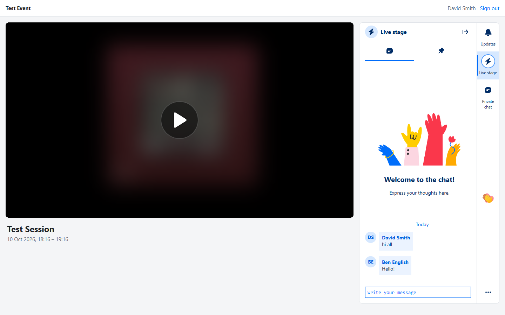
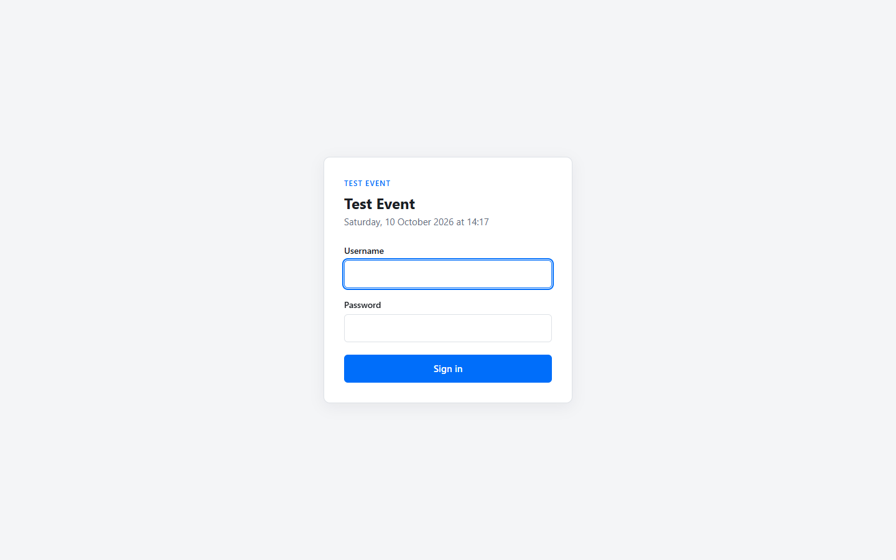
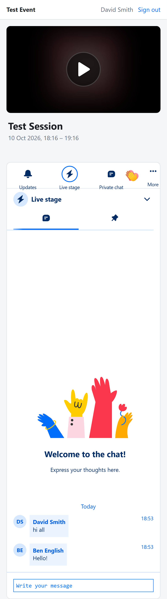

# Kaltura Event Site Example

[](../../actions/workflows/ci.yml)
[](LICENSE)

An example of building **your own event website** on top of **Kaltura Event Platform** (EP).

You run the event in Event Platform: create the event and sessions, invite attendees, and broadcast.
Attendees watch and interact on a site that **you** design and host. This repository shows how to
embed the two attendee-facing EP components **natively in your own pages, without iframes**:

* **Webcast player**: the Kaltura Player with your Event Platform player configuration
* **Chat & Collaboration (CnC)**: group chat, Q&A, polls, announcements, private chat and emoji reactions

<p align="center">
  
</p>

| Sign-in | Session (mobile) |
|---|---|
|  |  |

> **This is sample code.** It's a complete, tested starting point and reference implementation,
> not a supported Kaltura product. Review it, adapt it to your own identity provider, design and
> hosting, and test it before using it in production.

---

## What it does

The attendee journey is deliberately simple:

1. **Sign in** with a username and password. The site checks that the person is registered for the event in Event Platform.
2. **Session page** with the live webcast and Chat & Collaboration side by side (stacked on phones).
   If the event has several webcast sessions, the live-now or next one is shown, with a switcher.

Everything an organizer does (event, sessions, attendees, moderation, broadcasting) stays in Event Platform.

### What the example demonstrates

* Issuing a **playback-only Kaltura Session (KS)** for the player, generated locally on the server
* Signing the **CnC JWT** with the account's `cncAuth` app token
* Mounting the **player** and **CnC widgets** into your own DOM, in a layout you control
* Using the **Events Platform API** to read the event, its sessions and its registered users
* Mapping attendees to their **Event Platform identity**, so chat, Q&A, moderation and analytics line up with EP
* A **setup wizard** that discovers the IDs you need on your account
* Production basics: secrets kept server-side, signed `httpOnly` session cookies, CSRF protection,
  rate-limited sign-in, a Content Security Policy, health check, Docker image, CI, and unit/integration/browser tests

---

## Quick start

You need **Node.js 22.9+** and a Kaltura account with **Event Platform**.

```bash
git clone <this-repo-url> event-site && cd event-site
npm install
npm run setup                              # connects to your account and writes .env
npm run add-user -- attendee@example.com   # give an invited attendee a password for this site
npm run check                              # verifies the configuration against Kaltura
npm start                                  # open http://localhost:3000
```

The full walkthrough, including what to prepare in Event Platform first, is in
**[docs/getting-started.md](docs/getting-started.md)**.

> **Windows PowerShell:** if `npm` fails with *"running scripts is disabled on this system"*, use
> `npm.cmd` instead (e.g. `npm.cmd run setup`).

---

## Documentation

| Guide | What's in it |
|---|---|
| [Getting started](docs/getting-started.md) | Step-by-step: from an empty Event Platform event to a working site, and using the app day to day |
| [Kaltura setup](docs/kaltura-setup.md) | Everything the site needs on the Kaltura side and where to find each value |
| [Architecture](docs/architecture.md) | Components, request flows (with diagrams), security model, caching |
| [Integration guide](docs/integration-guide.md) | **How to rebuild this integration on your own platform**, in any language: KS, CnC JWT, Events API calls, front-end embedding |
| [Configuration](docs/configuration.md) | Every environment variable |
| [HTTP API](docs/http-api.md) | The site's own endpoints and response shapes |
| [Customization](docs/customization.md) | Plugging in your SSO, branding, layout, CnC options |
| [Testing](docs/testing.md) | Automated tests, the mock Kaltura backend, manual test plan |
| [Deployment](docs/deployment.md) | Production checklist, Docker, scaling |
| [Troubleshooting](docs/troubleshooting.md) | Symptoms, causes and fixes |
| [References](docs/references.md) | **The Kaltura documentation, repositories and APIs this is based on**, mapped to each part of the app, plus behaviour observed in testing |

---

## Project layout

```
src/
  server.js                 entry point (loads config, starts HTTP server)
  app.js                    Express app: pages, API routes, session cookie, CSP, token issuing
  config.js                 environment parsing and validation
  auth/authenticate.js      sign-in + Event Platform registration check (plug your SSO in here)
  auth/local-users.js       optional site-managed passwords (scrypt)
  kaltura/ks.js             local Kaltura Session (KS v2) generation
  kaltura/cnc.js            CnC JWT signing, cncAuth app token lookup/creation
  kaltura/api.js            minimal Kaltura API v3 client
  kaltura/events-api.js     Events Platform API client
  kaltura/discover.js       finds the EP player / CnC / reactions uiconfs on an account
  kaltura/admin.js          shared admin-KS factory
  lib/                      small utilities (TTL cache, .env override detection)
views/                      login.html, session.html
public/                     browser code: session.js mounts the player and CnC; styles; consent text
scripts/                    setup wizard, config check, add-user
test/                       unit, integration, setup wizard, mock Kaltura backend, Playwright e2e
docs/                       guides and screenshots
```

---

## References

The main sources are below. [docs/references.md](docs/references.md) maps every part of the app to the official
documentation it's based on.

* [kaltura/integrated-events-demo](https://github.com/kaltura/integrated-events-demo): Kaltura's reference for embedding CnC and the player
* [Events Platform public API (OpenAPI spec)](https://github.com/kaltura/mcp-events/blob/main/openapi-public-api.yaml)
* [Kaltura API documentation](https://developer.kaltura.com/api-docs/) · [docs.kaltura.com](https://docs.kaltura.com/)
* [Kaltura Player JS](https://github.com/kaltura/kaltura-player-js)
* [Kaltura API Authentication and Security](https://developer.kaltura.com/api-docs/VPaaS-API-Getting-Started/Kaltura_API_Authentication_and_Security.html) · [Application tokens](https://developer.kaltura.com/api-docs/VPaaS-API-Getting-Started/application-tokens.html)

## License

[MIT](LICENSE)
