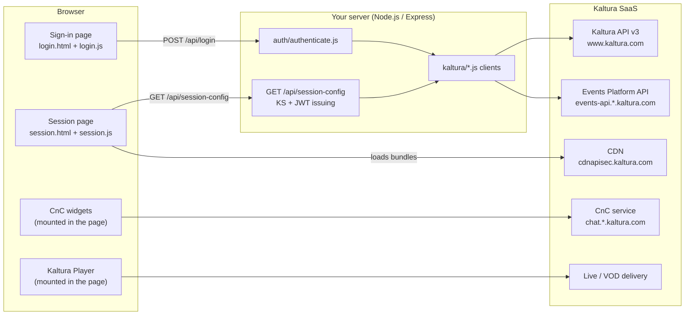
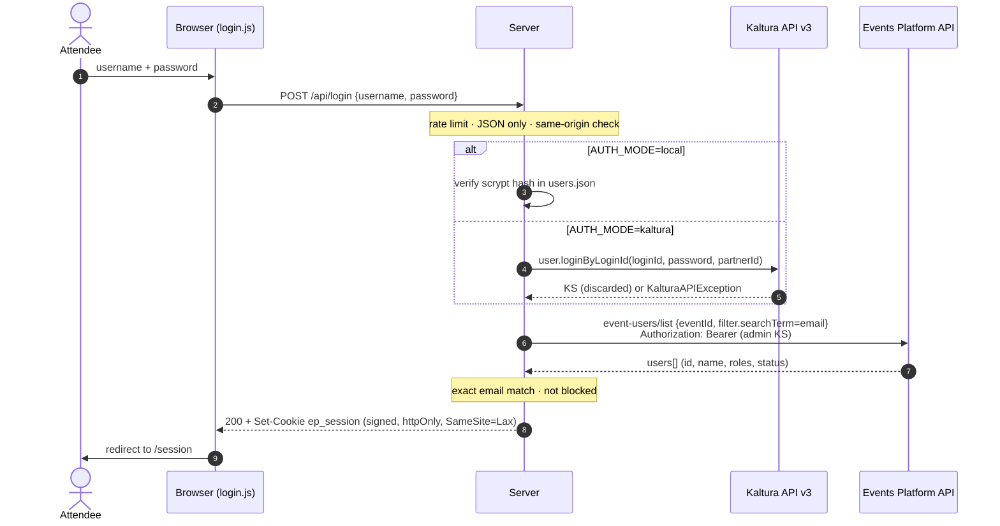
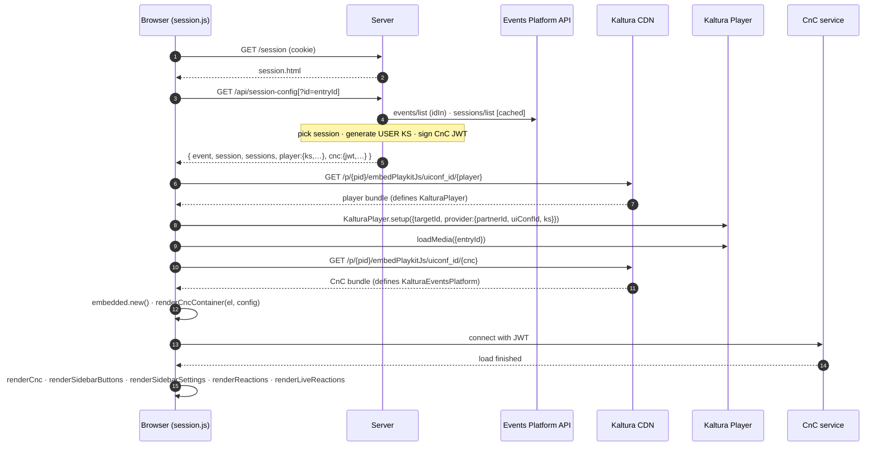

# Architecture

- [Overview](#overview)
- [Components](#components)
- [Flow 1: sign-in](#flow-1-sign-in)
- [Flow 2: loading the session page](#flow-2-loading-the-session-page)
- [Choosing the session](#choosing-the-session)
- [Identity mapping](#identity-mapping)
- [Security model](#security-model)
- [Caching and performance](#caching-and-performance)
- [Why not iframes?](#why-not-iframes)

---

## Overview

The server has three jobs:

1. **Authenticate** the attendee and confirm they're registered for the event.
2. **Issue short-lived credentials** for the two Kaltura components: a KS for the player and a JWT for CnC.
3. **Serve the pages.**

Everything else (video delivery, chat, Q&A, polls, moderation, analytics) happens directly between the
browser and Kaltura.

This design follows Kaltura's reference app [integrated-events-demo](https://github.com/kaltura/integrated-events-demo)
and its [BEST_PRACTICES.md](https://github.com/kaltura/integrated-events-demo/blob/main/BEST_PRACTICES.md); see
[references.md](references.md) for all sources.

---

## Components

| Layer | File(s) | Responsibility |
|---|---|---|
| Entry | `src/server.js` | Loads config, warns about stale env vars, starts HTTP |
| App | `src/app.js` | Routes, helmet/CSP, cookie session, rate limiting, session selection, token issuing |
| Config | `src/config.js` | Parses and validates environment variables; region defaults |
| Auth | `src/auth/authenticate.js` | Credentials check + Event Platform registration lookup |
| | `src/auth/local-users.js` | Site-managed passwords (scrypt) for `AUTH_MODE=local` |
| Kaltura | `src/kaltura/ks.js` | Local KS v2 generation (and parsing, for tests/tools) |
| | `src/kaltura/cnc.js` | CnC JWT signing; `cncAuth` app token lookup/creation |
| | `src/kaltura/api.js` | Kaltura API v3 calls (`user.loginByLoginId`, `appToken.*`, `uiConf.list`, `session.get`) |
| | `src/kaltura/events-api.js` | Events Platform API (`events/list`, `sessions/list`, `event-users/list`) |
| | `src/kaltura/admin.js` | Admin-KS factory shared by server and scripts |
| | `src/kaltura/discover.js` | Classifies uiconfs into player / CnC / reactions |
| Browser | `public/login.js` | Sign-in form, event header, branding |
| | `public/session.js` | Fetches config, loads Kaltura bundles, mounts player and CnC |
| Tools | `scripts/setup.js`, `check-kaltura.js`, `add-user.js` | Setup wizard, live config check, user management |

Runtime dependencies are intentionally few: `express`, `helmet`, `cookie-session`, `express-rate-limit`.
Kaltura calls use `fetch`, and the KS/JWT code uses `node:crypto`. No Kaltura SDK is required, which keeps
the integration easy to read and to port (see [integration-guide.md](integration-guide.md)).

---

## Flow 1: sign-in

The session cookie holds `{ user: { id, email, firstName, lastName, roles }, createdAt }`, signed with
`SESSION_SECRET` (tampering invalidates it). `id` is the attendee's **Event Platform user ID**.

---

## Flow 2: loading the session page

**Bundle order matters.** Both bundles come from `embedPlaykitJs` and share globals, so the player bundle
is loaded and the player set up **before** the CnC bundle loads.

---

## Choosing the session

`pickSession()` in `src/app.js`:

1. `?id=<entryId>` in the URL, if it's in the event and not private.
2. Else `KALTURA_SESSION_ID`, if set (private sessions allowed when pinned).
3. Else, among **LiveWebcast/SimuLive** sessions that aren't private, sorted by start time: the first
   that hasn't ended (live now or next), otherwise the most recent.

Sessions of other types return `422 unsupported_session_type`; the page shows a friendly message.

---

## Identity mapping

The same user ID flows everywhere, so Kaltura sees one person:

| Where | Field | Value |
|---|---|---|
| Event Platform | event user `id` | e.g. `1ef91ea6…` (hashed) |
| Site session cookie | `user.id` | same |
| Player KS | `_u` (user) | same → playback analytics per attendee |
| CnC JWT | `uid` | same → chat identity, Q&A, moderation, CnC analytics |

The attendee's display name in CnC comes from their Kaltura/EP profile.

---

## Security model

| Concern | Measure |
|---|---|
| Admin secret | Server-only (env var). Never in responses; tested. |
| CnC signing token | Server-only. Only the signed JWT reaches the browser. |
| Player KS | **USER** type · `setrole:PLAYBACK_BASE_ROLE` · `disableentitlementforentry:<this entry>` · `virtualeventid:<event>` · expires after `KS_EXPIRY_HOURS` |
| CnC JWT | Scoped to one entry (`contextId`) and event, `isAdmin:false`, `isScopedUser:true`, expires after `KS_EXPIRY_HOURS` |
| Session cookie | Signed (`cookie-session`), `httpOnly`, `SameSite=Lax`, `Secure` when `NODE_ENV=production`, expires after `SESSION_TTL_HOURS` |
| CSRF | State-changing endpoints require `Content-Type: application/json` and a same-origin `Origin` |
| Brute force | `express-rate-limit` on `/api/login` (`LOGIN_RATE_LIMIT` per IP / 15 min) |
| User enumeration | Same error for unknown user and wrong password; scrypt runs for unknown users too |
| Authorization | Registration (and block status) re-checked at every sign-in; private sessions not selectable |
| Headers | `helmet`: CSP (report-only by default, enforce with `CSP_ENFORCE=true`), `nosniff`, frame-ancestors `self`, etc. |
| Errors | Upstream failures become a generic `502 upstream_error`; details only in server logs |

---

## Caching and performance

| What | Where | TTL |
|---|---|---|
| Event (`events/list`) | in-memory | 5 min |
| Sessions (`sessions/list`) | in-memory | 1 min |
| `cncAuth` token (if not in env) | in-memory | 24 h |
| KS and JWT | generated per page load, **no API call** (local crypto) | – |

KSs are generated locally rather than with `session.start`, so loading the session page costs at most
two cached Events API calls, however many attendees arrive at once. Concurrent cache misses share a
single upstream request.

---

## Why not iframes?

Event Platform can be embedded with iframes, but rendering the components natively means:

* **Your layout.** The player, chat panel, sidebar buttons, settings and reactions are separate mount
  points you place anywhere.
* **Your page, your domain.** One document, one CSP, your fonts and styles around the components.
* **Programmatic control.** You get the `KalturaPlayer` instance and the CnC API object (open/close
  callbacks, unmount functions).
* **Responsive behaviour** that you define (see the mobile layout in `public/styles.css`).
